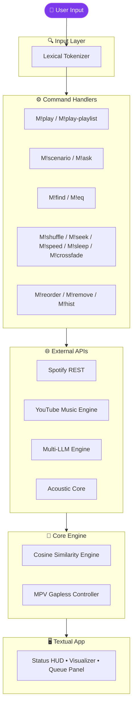

<div align="center">

# 🎵 TuneCLI
### *The Ultimate AI-Driven Terminal Audio Engine*

[](https://www.python.org/)
[](https://github.com/)
[](https://mpv.io/)
[](https://textual.textualize.io/)

**TuneCLI** is an ultra-fast, intelligent, and highly experimental terminal music environment built for developers, audiophiles, and terminal purists.

By fusing **YouTube Music's vast library**, **Spotify's machine-learning audio features**, **Multi-LLM Intelligence**, and **Acoustic Fingerprinting**, TuneCLI delivers a seamless, mood-aware, and futuristic listening experience completely from the command line — wrapped in a stunning **multi-theme Textual TUI**.

[Explore Themes](#-theme-system) • [Installation](#-quick-start--installation) • [Commands](#%EF%B8%8F-command-interface)

<br/>

</div>

---

## ✨ Engineering Highlights

<details open>
<summary><b>🎧 Machine Learning & Acoustic Analysis</b></summary>
Leverages Spotify's audio feature vectors and <b>Cosine Similarity</b> algorithms to curate mathematically perfect song transitions and recommendations based on track acoustics (valence, energy, tempo).
</details>

<details open>
<summary><b>🧠 4-Stage Unstoppable AI Search</b></summary>
A custom-built YouTube scraping engine that guarantees you find the <i>official studio release</i>. If strict audio filters fail, TuneCLI mathematically strips noisy keywords, and finally falls back to a <b>Multi-LLM Engine</b> to intelligently translate vague descriptions (<i>"that one song from titanic"</i>) into perfect metadata searches!
</details>

<details open>
<summary><b>✨ LLM-Driven Scenario Soundtracking</b></summary>
Integrates a <b>flexible Multi-LLM architecture</b> to analyze free-form user stories. Describe your situation (e.g., "Driving through the rain in Tokyo"), and TuneCLI will extract the mood, tone, and language to build a tailored 5-track scenario queue.
</details>

<details open>
<summary><b>🎙️ Ambient Audio Fingerprinting</b></summary>
Built-in acoustic recognition engine (<code>M!find</code>). Listen to your surroundings through your microphone or capture internal PC audio (<code>M!find sys</code>), instantly identify the playing track via Shazam, and natively queue it or its nearest AI neighbors.
</details>

<details>
<summary><b>🖥️ Reactive Multi-Theme TUI</b></summary>
A fully reactive, multi-zone Textual TUI with a live status bar HUD, dynamic queue panel, block-character logo banner, Now Playing display, and interactive modal dialogs — switchable across built-in colour themes at runtime with <code>M!theme</code>.
</details>

---

## 🚀 Quick Start & Installation

### Prerequisites
- **Python 3.10 or higher**
- **Audio Engine (`libmpv`)**:
  - **Windows**: Bundled out-of-the-box in `lib/` (zero manual installation needed!).
  - **macOS**: `brew install mpv`
  - **Linux (Ubuntu/Debian)**: `sudo apt install libmpv-dev mpv`

---

### ⚡ Option A: Single-Click Launch (Recommended)

#### 🪟 Windows
Simply double-click **`StartTuneCLI.bat`** in the repository root.
> Automatically verifies Python, builds the virtual environment (`venv`), installs all dependencies, and boots the application.

#### 🐧 Linux / 🍎 macOS
Make `start.sh` executable and run it:
```bash
chmod +x start.sh
./start.sh
```

---

### 🛠️ Option B: Manual Setup

```bash
# 1. Clone the repository
git clone https://github.com/hemahariharan1126/tunecli.git
cd tunecli

# 2. Create and activate a virtual environment
python3 -m venv venv
# On Windows: call venv\Scripts\activate
# On Linux/macOS: source venv/bin/activate

# 3. Install dependencies
pip install -r requirements.txt

# 4. Launch TuneCLI
python main.py
```

<details>
<summary><b>🔑 Optional: API Secrets (For AI & Spotify Recommendations)</b></summary>

TuneCLI runs out-of-the-box with YouTube audio streams. To enable Spotify acoustic vector analysis or AI scenario soundtracking, copy `.env.example` to `.env`:

```env
# Spotify API Credentials (Optional: for ML acoustic features)
SPOTIFY_CLIENT_ID='your_spotify_client_id'
SPOTIFY_CLIENT_SECRET='your_spotify_client_secret'

# Google Gemini API Key (Optional: for M!scenario, M!eq, and M!ask)
GEMINI_API_KEY='your_gemini_api_key'

# Ollama / Cloud LLM Endpoint (Optional alternate AI provider)
USE_OLLAMA_FOR_SCENARIO=false
OLLAMA_API_KEY='your_ollama_api_key'
OLLAMA_MODEL='gemma4:31b-cloud'
OLLAMA_BASE_URL='https://ollama.com/v1/chat/completions'
```
</details>

---

## ⌨️ Command Interface

Navigate TuneCLI using an intuitive, context-aware command parser prefixed with `M!`. 

| Command | Feature |
| :--- | :--- |
| `M!play <query\|url>` | Play by song name, YouTube URL, or Spotify track / playlist link. |
| `M!play-playlist <name>` | Search YouTube Music and Spotify catalogs for a playlist by name. |
| `M!find [seconds\|sys]` | **Ambient Recognition.** Listens to mic or internal PC audio (`sys`) to identify the track. |
| `M!hist` | **Playback History.** View and instantly replay your last 50 songs and playlists. |
| `M!scenario <story>`| **Story-Based Soundtrack.** Describe your situation to the AI for an auto-generated set. |
| `M!ask <prompt>`| **Natural Language Search.** Identify and play songs from vague lyrics or plot lines. |
| `M!recommend` | Computes acoustic vectors of the current track to queue nearest neighbors. |
| `M!radio <on\|off>` | Infinite algorithmic generation of related tracks matching the current song. |
| `M!mood <mood>` | Mutate the queue using semantic mood filters (`sad`, `chill`, `party`, `focus`). |
| `M!theme <name>` | **Hot-swap UI theme.** Choose from 8 cinematic and aesthetic palettes. |
| `M!eq [on\|off\|reset\|info]`| AI-optimized 10-band equalizer customized per song. |
| `M!shuffle [on\|off]` | Toggle or set randomized queue playback (or press `s`). |
| `M!seek <time\|pos>` | Jump position (e.g. `1:30`, `+30`, `-15`, `50%`, or Left/Right arrows). |
| `M!speed <rate\|normal>` | Adjust playback speed (0.25x to 4.0x). |
| `M!sleep <min\|off>` | Schedule auto-stop timer (e.g. `30`, `1h`, or `off`). |
| `M!crossfade <sec\|off>`| Smooth track transition fade duration (1-10s). |
| `M!loop [off\|one\|all]` | Repeat off, repeat one track, or loop entire queue. |
| `M!source [yt\|ytmusic]` | Switch search backend between yt-dlp and YouTube Music API. |
| `M!lang [code\|reset]` | View or override language lock (`ta`, `hi`, `te`, `ml`, `kn`, `en`). |

<details>
<summary><b>View standard playback controls & hardware keybindings</b></summary>

- `M!pause` / `M!resume`: Pause or resume audio (or press Space, or Bluetooth button).
- `M!skip` / `M!next`: Jump to next track (or press `n`, or Bluetooth next).
- `M!prev`: Return to historical track (or press `p`, or Bluetooth prev).
- `M!queue`: View upcoming track sequence in the interactive panel.
- `M!remove <index>`: Delete a specific song from the upcoming queue.
- `M!reorder <from> <to>`: Move a song within the queue.
- `M!volume <0-100>`: Manipulate audio gain (or `+` / `-` keys).
- `M!help`: Interactive command reference table.
- `M!update`: Pull latest changes directly from Git.
- `M!exit` / `M!quit` / `M!end`: Clean shutdown and cache purge.
- **Hardware & Bluetooth Controls**: Global support for Bluetooth headsets (Play/Pause, Next, Prev) and keyboard media keys via OS-level event bridging.
</details>

---

## 🎨 Theme System

TuneCLI ships with built-in colour themes, switchable instantly at runtime with `M!theme <name>`. Your choice persists across restarts via `.env`.

<details>
<summary><b>Click to preview all available themes!</b></summary>

| Theme | Accent | Background | Vibe | Command |
| :--- | :---: | :---: | :--- | :--- |
| `cyberpunk` ⚡ | `#00d4ff` | `#080810` | Synthwave default | `M!theme cyberpunk` |
| `jarvis` 🤖 | `#00e5ff` | `#040a14` | Stark Tech HUD | `M!theme jarvis` |
| `matrix` 💻 | `#00ff41` | `#020a02` | Digital rain green | `M!theme matrix` |
| `batman` 🦇 | `#e5a93b` | `#08080a` | Gotham dark & gold | `M!theme batman` |
| `spiderverse` 🕷️ | `#ff0055` | `#0a0208` | Neon glitch comic | `M!theme spiderverse` |
| `bladerunner` 🛸 | `#ff6b1a` | `#0a0503` | 2049 amber haze | `M!theme bladerunner` |
| `dracula` 🧛 | `#ff79c6` | `#282a36` | Classic dev dark | `M!theme dracula` |
| `black` 🖤 | `#ffffff` | `#000000` | Minimal monochrome | `M!theme black` |
| `red_velvet` 🍷 | `#e8234a` | `#1a0008` | Warm dark luxe | `M!theme red_velvet` |
| `ocean` 🌊 | `#00e5cc` | `#020d1a` | Cold calm depth | `M!theme ocean` |
| `forest` 🌿 | `#39d353` | `#050f06` | Nature night mode | `M!theme forest` |
| `sunset` 🌇 | `#ff8c00` | `#120a00` | Golden hour glow | `M!theme sunset` |
| `rose_gold` 🌸 | `#e8a0b0` | `#120d0f` | Soft elegant | `M!theme rose_gold` |

</details>

---

## 🏗️ Architecture Under the Hood

TuneCLI is built modularly. You can expand it easily by adding new commands to the `commands/` directory.

<details>
<summary><b>View System Data Flow (Mermaid Graph)</b></summary>


</details>

<details>
<summary><b>View Directory Structure</b></summary>

```text
tunecli/
├── api/                # Stateful HTTP clients (Spotify REST, YTMusic, LLM)
├── commands/           # Pluggable CLI command handlers (play, ask, theme, etc.)
├── core/               # State machines and configuration management
├── equalizer/          # 10-band audio equalizer profiles
├── parser/             # Lexical parsing and command dispatch routing
├── player/             # libmpv abstractions and queue synchronization
├── recommender/        # ML Vector processing for semantic/acoustic matching
├── search_engine/      # 4-Stage Iterative Search engine
├── ui/                 # Textual TUI — app, components, styles, and themes
├── utils/              # Shared helpers (history manager, formatting)
├── logo.txt            # Block-character banner
├── StartTuneCLI.bat    # Windows 1-Click Launcher
├── start.sh            # Linux/macOS 1-Click Launcher
└── main.py             # Application Entrypoint
```
</details>

---

<div align="center">
Built with ❤️ for the terminal.
<br>
<i>Empowering developers to never leave the CLI for their music again.</i>
</div>
